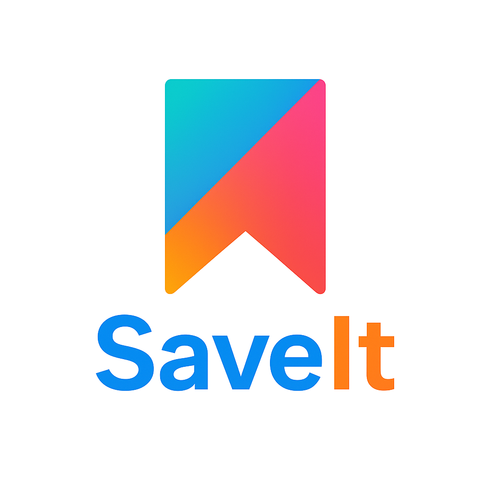

# SaveIt

<div align="center">
  
  <h3>A Modern Bookmark Manager for Chrome</h3>
  <p>Beautifully organize and access your bookmarks directly from the new tab page.</p>

  <p>
    <a href="#features">Features</a> •
    <a href="#installation">Installation</a> •
    <a href="#usage">Usage</a> •
    <a href="#customization">Customization</a> •
    <a href="#contributing">Contributing</a> •
    <a href="#license">License</a>
  </p>
</div>

## 🌟 Features

- **Category & Section Management** — Organize bookmarks into categories and collapsible, renamable sections arranged across a two-column board
- **Per-Section Row Layouts** — Choose 1, 2, or 3 bookmarks per row for each section using the column layout icons
- **Instant Search** — Press `/` to quickly filter bookmarks and sections within the selected category
- **Open Tabs Integration** — Drag open tabs directly into any section, click **Save all** to capture every open tab into a dated section, or click a tab to switch to it
- **Backup & Restore (Import / Export)** — Export your categories, sections, bookmarks, and layout settings to a JSON file and import them into any browser
- **Drag and Drop** — Reorder categories, sections (across columns), and bookmarks with smooth drag-and-drop
- **Collapsible Panels** — Show or hide the **Categories** and **Open tabs** sidebars from the top bar
- **Data Privacy & Zero Tracking** — All data is stored locally in your browser using IndexedDB; nothing is sent to external servers

## 🚀 Installation

1. Clone or download this repository
   ```bash
   git clone https://github.com/Ismailco/SaveIt.git
   ```
2. Open Chrome and navigate to `chrome://extensions/`
3. Enable "Developer mode" in the top-right corner
4. Click "Load unpacked" and select the folder containing this extension
5. The extension is now installed and will override your new tab page

## 📖 Usage

- Open a new tab to launch SaveIt
- Click **Add category** in the left sidebar to create a category
- Inside a category, click **Section** to create a collapsible group or **Bookmark** to save a link manually
- Use the vertical line icons (`|`, `||`, `|||`) on any section header to display 1, 2, or 3 bookmarks per row
- Drag an open tab from the **Open tabs** panel onto a section to save it, or click **Save all** to save all open tabs into a section named after today's date
- Click any item in **Open tabs** to jump straight to that browser tab
- Press `/` to focus the search bar and filter bookmarks in the current category (`Esc` to clear)
- Use the **Categories** and **Open tabs** buttons in the top bar to toggle sidebar visibility
- Open the **Settings** (gear) menu to **Export data**, **Import data**, **Customize Chrome**, or **Expand / Collapse all sections**

## ✨ Customization

If you want to change the appearance or behavior of the extension:

- `newtab.css` — Tweak the design tokens, layout grid, and component styling
- `newtab.js` — Customize functionality and behaviors
- `newtab.html` — Adjust the structure and layout
- Replace the icon files in the `icons` folder with your own designs

## 🤝 Contributing

SaveIt was initially created for personal use but has evolved to be shared with the community. Contributions are welcome and appreciated!

1. Fork the repository
2. Create your feature branch (`git checkout -b feature/amazing-feature`)
3. Commit your changes (`git commit -m 'Add some amazing feature'`)
4. Push to the branch (`git push origin feature/amazing-feature`)
5. Open a Pull Request

Feel free to open issues for bug reports, feature requests, or general feedback.

## ⚠️ Notes

- This extension uses IndexedDB, which means data is stored locally in your browser
- Clearing browser data can remove saved bookmarks — use **Settings → Export data** to keep a JSON backup or move your workspace between browsers
- The extension requires the `tabs` permission to list, save, and switch to your open tabs

## 📄 License

This project is licensed under the MIT License - see the [LICENSE](LICENSE) file for details. You are free to use, modify, and distribute this code for personal or commercial purposes.

## 💡 About

SaveIt is a personal project to streamline bookmark management. If you find it useful, please star the repo

---

<div align="center">
  <p>Made with ☕ by <a href="https://ismailcourr.dev">Ismail Courr</a></p>
</div>
